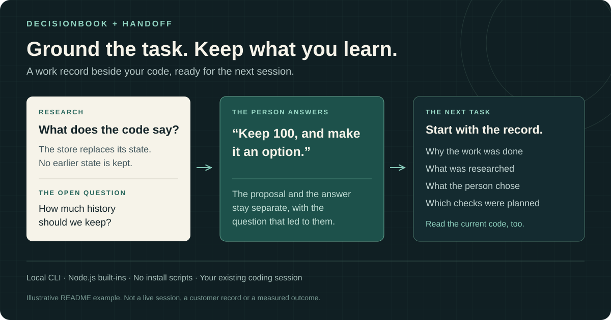

# DecisionBook + Handoff

**Your code has history. Your decisions should too.**

Ground the task. Keep what you learn. A local work record for Claude Code, kept beside your code.

[Quick start](#quick-start) · [Example record](#what-a-plan-looks-like) · [Guide](GUIDE.md) · [Privacy](PRIVACY.md) ·
[Security](SECURITY.md) · [Changelog](CHANGELOG.md)

*An illustration of the example record below, not a screen of the product.*

A coding agent can read the implementation. It cannot recover from the code every product choice, limit or exception
behind it, and the reasons for a change leave with the chat that produced them. The next session asks you again, or picks
an answer for you without asking.

**DecisionBook** changes the order of the work. Before a change, the agent researches the existing code and evidence. It
asks you what the code does not answer, each question with the answer it proposes. The research, its findings, the
questions, your own answers, the reasons and the checks stay together in the work's record, a plain file in your
repository. **Handoff** carries the ongoing work into a new session after `/clear`. Later work on the same files is handed
the related earlier records, each marked as no proof that the code still does it today, so the agent checks them against
the current code.

- **It asks before code.** Before your AI session edits a file you protect, it reads the code, writes a short plan and asks
  you what the code cannot answer, each question with the answer it proposes.
- **Your decision, in your own words.** Your own AI reads your answer and records what it understood you decided, with your
  words beside it. A decision recorded as yours must quote words you typed in that session; a record that does not is
  refused.
- **Protected files need an approved plan.** An AI edit of a protected file needs a READY plan, and a plan is READY only
  after your yes.
- **`/clear` and teammates keep it.** Handoff carries the work across `/clear`; DecisionBook keeps plans and decisions as
  plain files in `.decisionbook/`, so a teammate who pulls gets them too.

What it is not: **not a chat log** (the repository gets the plan, its research, questions, decisions and checks, not the
conversation), **not a code map** (it keeps what the agent read and where, as `file:line`, not a model of your code), and
**not an agent memory** (it keeps the decisions a person made, tied to plans and files, not everything a session saw).

**Built on Node.js built-ins. No third-party runtime packages, no bundled third-party libraries, no install scripts.** It
calls no model of its own and needs no account: your existing Claude Code session does the AI work.

## Find your way

| I want to… | Start here |
|---|---|
| Try it in a repository | [Quick start](#quick-start) |
| See the data it keeps | [What a plan looks like](#what-a-plan-looks-like) |
| Understand the two tools | [DecisionBook](#what-decisionbook-does) · [Handoff](#what-handoff-does) |
| Use it with a team | [Teams and git](GUIDE.md#teams-and-git) |
| Know what is kept where, and what is sent | [Local by design](#local-by-design) · [Privacy](PRIVACY.md) |
| Fix a setup that does not work | [Troubleshooting](GUIDE.md#troubleshooting) |
| Read the measured results and their caveats | [The long-task experiment](#one-long-task-experiment) |
| Report a bug | [Open an issue](https://github.com/Bariscanates404/decisionbook/issues/new/choose) |
| Report a security problem privately | [Security](SECURITY.md) |
| Contribute, or ask about licensing | [Contributing](CONTRIBUTING.md) · [Licence](#licence) |

## Quick start

**Requires** Node 22 or newer, git (setup works inside a git repository), and Claude Code (its hooks and slash commands;
no minimum Claude Code version is checked). On Windows, Git Bash too.

    npm install -g atlasbound
    cd your-repository && atlasbound setup

Your project can stay on its own Node version: install AtlasBound with Node 22 or newer and run its commands with that
Node; setup writes that Node's path into the hooks, so they run it whatever Node your project uses. With nvm on macOS or
Linux: `nvm exec 22 npm install -g atlasbound`, then `nvm exec 22 atlasbound setup`. nvm-windows has no `exec`: run
`nvm use 22`, then `npm install -g atlasbound` and `atlasbound setup`; `nvm use` switches Node for the whole machine, so
keep it on 22 or newer while you use AtlasBound.

`setup` wires six hooks and four slash commands (`/decisionbook`, `/decide`, `/handoff`, `/resume-handoff`) into this repository's
local Claude Code settings, adds a block to `.gitignore` and one team notice row to `.claude/settings.json`, and then asks
you one question: what to protect. It shows what it would pick, for example:

    automatic: lib/** (6 files), tests/** (110 files), typings/** (2 files)  ->  atlasbound protect --source
    choose: the paths the person names  ->  atlasbound protect "<path or glob>[,...]"

The answer is yours. Type it yourself, or answer your AI session: it is told to ask you rather than choose, and it may run
the command itself after your answer, since adding protection is something it may do. Only taking protection away is yours:
`atlasbound protect --none` runs only when you type it at your own terminal, and an AI edit of AtlasBound's own files
(`.decisionbook/`, its hook and permission entries in `.claude/settings.local.json`, its `.gitignore` block, its slash
commands) or of a Claude Code settings file that can switch its hooks off (`.claude/settings.json`, yours in `~/.claude/`)
asks you first.

    atlasbound protect --source
    atlasbound doctor           # "doctor: ok": what is installed and wired, and whether the installed files match this release

Commit `.gitignore` and `.claude/settings.json`; the files that name this machine stay out of git. The team notice row tells a
teammate's Claude Code session, once per session, to install and set up when their machine is not set up yet. Each
teammate then runs `atlasbound setup` once, and plans arrive with `git pull` ([teams and git](GUIDE.md#teams-and-git)). A
repository set up by an earlier version gets the row with `atlasbound setup --team-notice`, then a commit of `.claude/settings.json`.
Now start Claude Code in the repository (or restart it, so it picks up the hooks) and give it a task that touches a
protected file:

| Step | What happens |
|---|---|
| **It researches and asks** | The product hands the agent a pre-filled plan skeleton for the area; the agent reads the code itself, sends the plan with one `atlasbound decisionbook new`, and shows you every open question in one message, each with the answer it proposes. No code yet. |
| **You answer in your own words** | Answer any way you like: one by one, "go with your suggestions", "yes, but keep the old limit". Your AI records what it understood you decided, with your words beside it; a record whose words are not in a message you typed in that session is refused, and so is a yes with no message of yours behind it. An answer you relay ("I asked Ayşe: keep 100") is recorded as yours, with the name of the one you asked. |
| **It builds from the plan** | Once the plan is READY it is frozen, and the edits inside it go through in the sessions that work on it; a session that began with another task plans its own. A protected file the plan does not name is asked first: your yes to that edit adds it to the plan. When the work is done, `atlasbound decisionbook close <id>` links the plan's own commits, files and tests and prints the one `git commit` command for that record: the product never commits for you. |
| **It continues in a fresh session** | Type `/handoff`: the note keeps up to seven lines quoted from your own messages, what is half-done and the next steps. Then `/clear`, then `/resume-handoff`: the new context starts from that note and from DecisionBook's settled decisions, and does not ask again what you already decided. |

To take it all out again: `atlasbound uninstall` (you type the phrase it names, at your own terminal).

<!-- demo slot, an absolute https URL once recorded:

-->

## Local by design

| Surface | What to know |
|---|---|
| **Work records** | Plain JSON lines in `.decisionbook/`, one file per plan, appended and never rewritten; yours to review and commit with the code. |
| **Handoff** | A note per branch and short excerpts of your messages, in your home folder (`~/.atlasbound/`), never in the repository. |
| **Model use** | The product calls no model. What its hooks add to your Claude Code session becomes part of that session, which goes to the model provider your session already uses, under your account, like the rest of the session. |
| **Network** | This build sends nothing: telemetry has no address. It is off unless you turn it on yourself at a plain terminal, and setup does not ask about it while there is no address. |
| **Package** | Node.js built-ins only: no dependencies, no bundled third-party code, no install scripts. |

[PRIVACY.md](PRIVACY.md) says exactly what is kept where and how to remove it.

## What a plan looks like

One plan is one file in `.decisionbook/`. The tool appends one JSON record per line rather than rewriting earlier records.
Here is an abbreviated example for undo and redo in a small state library, laid out for reading:

> **Plan:** Add undo and redo. *Why:* users want to step back through state changes. *Level:* normal.
>
> **Research** (read `src/store.js:12`): `setState` replaces the state object; no earlier state is kept.
>
> **Question Q1:** How many past states should the store keep? *Proposed:* keep the last 50.
>
> **Decision, by the person:** "Keep 100, and make it an option." *(answers Q1; the AI's reading: a `historyLimit` option, default 100)*
>
> **Check AC-1:** undo after two changes restores the first. *Command:* `npm test -- store`
>
> **Ready:** frozen; planned file `src/store.js`.

Later sessions can retrieve the recorded decisions for `src/store.js`, with the person's words and who made them.

## What DecisionBook does

- Before an AI session edits a protected file, it needs a READY plan at its level (small fix, normal, critical). The agent
  proposes the level and code only raises it: a small fix that plans more than 2 files, a glob or any risk signal runs as
  normal work (unless it writes only tests, fixtures or docs); a path under `danger` or another hard signal, or a soft one you did not waive, makes it critical; no level
  proposed is critical; a proposal is never lowered. A small fix needs its files, your answers to its blocking questions and your yes; normal work adds a success signal, a check with its command and the questions the task
  leaves open; critical work the whole form ([levels](GUIDE.md#settings)). While a decision of the plan holds a conflict (two
  answers a merge kept), the plan covers no edit until you say which holds.
- When a new plan starts in an area with earlier work, the agent receives a bounded context pack: selected decisions,
  assumptions no person confirmed, checks, and a plan template. Each earlier decision says where it came from, and that it
  is no proof the code still does it today.
- Plans, research, questions, decisions and links to files, tests and commits are plain JSON lines in `.decisionbook/`.
  Later sessions and teammates can inspect earlier work with `atlasbound decisionbook related <path>`,
  `atlasbound decisionbook show file:<path>` and `atlasbound decisionbook inbox`.
- Records matching the built-in secret patterns are refused before they are written. This is pattern screening, not a
  guarantee that every secret is detected.

## What Handoff does

- Handoff does not gate file edits and does not ask questions by itself. Using Claude Code's reported token usage, it gives
  at most one notice per session when the context passes 55 %.
- `/handoff` refreshes the note from facts such as the branch, HEAD, changed files and plan state, and gives the agent the
  locally kept excerpts of your messages to work from, so the lines it keeps are quoted from you rather than recalled.
- Notes are stored per branch in your home folder, outside the repository; message excerpts are stored per session. They
  are given to your own Claude Code session; the product makes no model calls of its own.
- `atlasbound handoff drop <n>`, typed by you, removes a kept line from the handoff note.

## What to expect

The first recorded task already leaves something you can use: its purpose, what the agent found in the code, the questions
it asked, your answers, and its checks. You can continue from that record after `/clear`.

As more work is recorded, later sessions and teammates can retrieve relevant earlier plans before they change the same
area. A bug fix can consult why the behaviour was chosen; a new feature can reuse earlier research and find the exceptions
you already named. The history covers work recorded through DecisionBook; older, unrecorded work still has to be
researched.

## One long-task experiment

A long task on **Mastodon** (Ruby on Rails): one large feature, Opus 5.5, 22 decisions the task text leaves open, 94 hidden
tests, and the context cleared several times in each run. We compared Claude alone, Claude with one paragraph in
`CLAUDE.md` that tells it to ask before coding, and Claude with DecisionBook and Handoff. A script supplied the developer's
answers from a prepared list. These are two runs of the same sealed task, not a general benchmark; session costs are
estimates at list prices, not subscription charges. The runs used an earlier build; the way answers are recorded has changed
since.

| Run | | Hidden tests passed (of 94) | Decisions asked (of 22) | Asked again after answered | Kept across a cleared context | Contradicted later | Session cost |
|---|---|---|---|---|---|---|---|
| 1 | Claude alone | 64 | 0 | – | – | – | 13.04 USD |
| 1 | Claude + one paragraph | 84 | 13 | 8 decisions, 15 times | 12 of 13 | 1 | 24.04 USD |
| 1 | with DecisionBook + Handoff | 83 | 10 | 0 | 10 of 10 | 0 | 26.18 USD |
| 2 | Claude alone | 70 | 0 | – | – | – | 13.27 USD |
| 2 | Claude + one paragraph | 82 | 11 | 8 decisions, 15 times | 10 of 11 | 1 | 22.92 USD |
| 2 | with DecisionBook + Handoff | 84 | 14 | 0 | 12 of 14 | 2 | 17.79 USD |

In these runs both asking arms passed more hidden tests than Claude alone. Their scores were close; two runs are not
enough to show a quality difference or an equivalence. In each run the paragraph arm asked eight answered decisions again,
15 times; DecisionBook asked none again. Separately, in each product run one answer had to be sent a second time because
the guard did not accept its first wording. "Kept" and "Contradicted" are labels derived from the hidden behaviour tests,
not direct measurements of the model's memory.

What the product adds is the record: research, questions, answers and checks are stored together, and relevant earlier
work is brought into a later session. A separate comparison on nine short tasks was less favourable to the product,
including a higher session cost (18.06 USD against 12.40 USD for the paragraph arm); we show the long task because long,
interrupted work is what the product is built for. The tasks, runs and scripts are available on request: open an issue.

## Limits

- **A workflow guard, not a sandbox.** It checks the agent's write tools before they run, and the shell, PowerShell and
  `cmd` commands it can read, package scripts (`npm run`, `npm test`, yarn, pnpm) included; a command of those kinds it
  cannot read, that may write a protected file, asks you instead of passing. A program run by an interpreter (`node x.js`,
  `python x.py`, `make`, a test runner) is not read before it runs: a protected file it changes is named when the session
  stops, after the fact. It is not designed to stop a deliberate bypass.
- **Claude Code only.** No other coding agent, no editor plugin and no server today. Tested on macOS and Linux; on Windows,
  see the next section.
- **A plan covers files, not intentions.** An existing READY plan can cover later work on the same files. Check that a
  new piece of work has its own plan.
- **Your AI decides what you meant.** The product checks only that the words beside a decision are yours: it refuses a
  record whose words are not in a message you typed in that session. That stops an AI that misreads or invents; it is not
  built to stop one that attacks the product's own files. Whether a hook call comes from Claude Code itself is checked on
  macOS only (elsewhere a shell command that names the hook is denied, a script that starts it is not seen); a program
  that stands in for Claude Code, or a second one started on the same session, is heard as you; an answer you pick in a
  question dialog is no typed message, so the AI asks again in plain words. The product does not check that the value is
  what you meant: `atlasbound decisionbook show <id> decisions` prints your words beside it.

## Windows

Windows is newer ground than macOS and Linux. The gate also watches Claude Code's PowerShell tool and reads the common
PowerShell and `cmd` ways of writing a file; a PowerShell or `cmd` command it cannot read that may write a protected file
asks you instead of passing.

What was run on Windows: release 0.25.2 by hand on Windows 11, with real Claude Code sessions (install, `doctor`, the answer
flows, a team's shared history); before it, an automated job installed the packed package on Windows and Linux, ran setup,
protect and doctor, and sent scripted writes through the hooks setup wrote. This release, 0.25.3, was run the same way on
Windows 11: an upgrade from 0.25.2, a clean install, the answer flows, Handoff after `/clear`, and two- and three-person team
histories, with real Claude Code sessions. CHANGELOG.md lists each change.

- **Git Bash is needed.** The hooks `setup` writes are shell commands. Claude Code on Windows runs them through Git Bash,
  which comes with Git for Windows; without it these commands fail, and nothing is gated.
- **Line ends.** Git for Windows sets `core.autocrlf=true` by default, so after a pull or checkout `.gitignore` may have
  Windows line ends. The product reads its `.gitignore` block either way.
- **A slash command from Git Bash.** Git Bash rewrites an argument that starts with `/` into a Windows path, so
  `claude -p "/handoff"` does not reach Claude Code as `/handoff`. Set `MSYS_NO_PATHCONV=1` for that command.
- **Links.** Making a symbolic link on Windows needs Developer Mode. A directory junction needs nothing, and the gate
  follows it to the folder it points at, as it follows a link.

If something does not work on Windows, please tell us in an issue.

## Privacy

Plans and decisions are in your repository: the plan file under `.decisionbook/` holds your answers in your own words, by
design, and it is yours to commit. The heads of your messages and the handoff note are only in your home folder. A draft
your AI session writes for a command (`.atlasbound/drafts/`, out of git) is removed once the command takes it, and kept when
the command refuses it, so a refused one may hold your words. The trace keeps a digest of what a step was given, never the
text of your prompt. Telemetry holds step counts, ranges and outcome codes, never your text, and it is off unless you turn
it on yourself at a plain terminal (`atlasbound telemetry on`). The product sends nothing anywhere in this build: telemetry
has no address yet, so setup does not ask about it. What it gives your Claude Code session goes where that session already
goes. A later release that can send tells you at setup before anything leaves; `atlasbound telemetry status` says what is
set. Details: PRIVACY.md.

Versions before 0.25 were an earlier, closed product under the same name, and it did send telemetry by default. If you
used it, CHANGELOG.md says what it sent and how to remove what it left in your home folder. A Claude Code session that was
open before you upgraded keeps that product's server running in memory, still sending: close every such session and start it
again, then run `atlasbound leftovers`, which names what is left and any such server that still runs.

## Free, and for teams

**Free: this package.** Everything above, with no account and no sign-up, for one person or for a team. A team shares it
through git: commit `.decisionbook/` (its `config.json` too, so what you protect travels with it), and a teammate who pulls
gets the plans and the decisions in the words they were given. The handoff note stays in the home folder of the machine
it was written on. GUIDE.md's [teams and git](GUIDE.md#teams-and-git) says what travels and what does not.

**Enterprise: a paid offer for team use.** For what git does not carry: one shared place where a team, signed in, reads its
plans and decisions without waiting for a push. It is in a pilot, and its price is not published. Nothing in this package
sends anything to it. To ask about it, open an issue in the public repository.

## AtlasBound and Bound

AtlasBound is the name over the products. DecisionBook and Handoff are its open product: this package. Bound is a separate,
optional, closed add-on in a closed beta for enterprise customers. It is not part of this package, and nothing here needs it.

## Licence

AGPL-3.0-only. Copyright (C) 2026 AtlasBound; see NOTICE and LICENSE.

The source of this exact release is the public repository at tag `v0.25.3`: https://github.com/Bariscanates404/decisionbook. The npm package is
the five folders of `packages/` there and the six root documents, byte for byte for every file it ships, and three files
written when it is packed: `kit.cjs` (one line that loads the kit folder), the npm `package.json`, and `MANIFEST.json`, which
lists every other file's sha256. The README and the repository's presentation on its default branch may change between
releases; the release tag is what to compare with the package.

For alternative licensing terms, open a commercial-licensing enquiry in the public repository. Any alternative licence will
be provided under a separate written agreement.

Contributions: see CONTRIBUTING.md in the public repository. The names AtlasBound and DecisionBook: see NOTICE.
