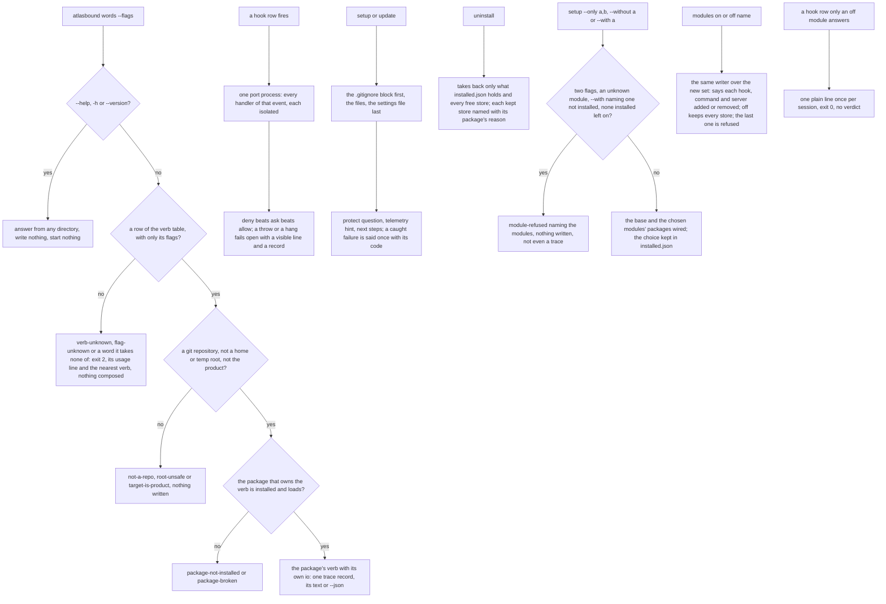

# @atlasbound/cli

The `atlasbound` bin and the one composition root. It reads the arguments, finds the repository, creates `io` once per process and hands each package
its own `io` through the package's public entry; it is the only writer of the host files (the settings file, `.mcp.json`, commands and skills, the
`.gitignore` block) and the one hook port every hook row runs. It knows no package's inside: a package's `package.json` `atlasbound.*` and its entry are
its whole interface.

## The flows the tests prove

## Expected behaviour

- Modules are data (`contracts/modules.json`): the base (shared code, telemetry) is always wired; `handoff` and `decisionbook`
  (the `decisionbook` package; its short alias `db` works but is offered nowhere) are each on or off per repository; an add-on brings its own row in the manifest of one of its packages (`module`), read only where that package is installed, wired only when a person names it, its packages answering before these. `has` is on disk,
  `wired` is on disk and on here, and every hook row, command, allow rule, hook dispatch, doctor and status row asks `wired`. Setup with no
  flag wires the choice stored here, or on a repository never set up every module that is not `optIn` (DecisionBook and Handoff); `update` keeps the choice; `atlasbound modules` says on, off (by choice) or not installed with what you lose; off never
  removes a store, and its reply lists each turned-off package's own `keptStores`, never a hand-written list. A package asking a sibling's answer through the root gets null with the reason as
  data, `absent(<answer>)`: `off` (by choice) or `not-installed`; no package looks up a module name. No npm lifecycle script exists.

- A command typed wrong (an unknown verb or group word, a flag or a word the verb does not take) exits 2 with its usage line and the nearest
  verb; any other refusal exits 1. With `--json` a refusal is also `{"error": {code, message, next}}` on stdout; a JSON word that does not read
  says where it broke, or that none was given. The help keeps every line within 100 columns (an example command stays whole). What a terminal
  shows is the person's: with stdout a terminal no AI session's memory shortens an answer or counts it as read.
- Setup twice writes the same bytes; a person's own lines and files survive setup and uninstall; a link in one file's path refuses that write alone.
- Every hook row names this machine's node and bin as absolute paths; where that node is gone (a Node switch) the node on PATH runs the
  port; only a row with no node at all, or its bin gone, says one plain line, exit 0, and blocks nothing (the line sits in the row's `else`, so a shell whose `exec` comes back never says it). A row is POSIX sh: on Windows
  the host runs hooks in Git Bash, which Claude Code needs there; a hook's paths are read as Windows opens them (`/c/...` is `C:\`).
- Doctor is never green on silence: each package and machine probe is measured, not measured, or a problem; a required package missing is a problem.
- Doctor holds every promise against its code (`core/capabilities`): each verb row's package call and render, each answer a manifest provides, each manifest hook's handler, each free MCP tool.
  One with no code is said as `capability-missing` (not a problem: `ok` stays the packages' and
  probes'); `debug doctor` lists each in `capabilities`, and the released tarball is held to none missing.
- A failure the verb goes on past is one line with its code once and one trace record (an uncoded error is recorded by its name only); a refused verb exits non-zero
  with its code, a package's code as that package wrote it, from a package verb or a cli step.
- Uninstall asks each installed package for its spare stores (`spareStores`), its home stores (`homeStores`) and why its kept stores stay (`keptStores`, DecisionBook's
  too); a spare store another package keeps stays; a folder of a product
  package not installed here is called that package's, any other folder no installed package names is called not ours. `--purge` takes the kept stores too,
  only after it names them (a folder no installed package names as "other files under .atlasbound") and the person types the phrase
  `uninstall purge`; any other answer is `phrase-not-typed`, and nothing is removed. The question names the one list the purge then removes:
  the team's files, a plan store git tracks and a home folder that is not there are not in it, and a store holding an empty folder
  goes whole.
- `atlasbound debug trace` and `debug doctor` answer `ab-debug/1`; a verb that only reads the trace leaves no new trace file; `--pkg` with no record of
  that package says so and names the packages there are (`--json`: `records: []`), never a blank answer. `--last` is the newest work run and ends with one
  line naming a newer run that only looked (doctor, decisionbook plan) and `debug trace <run>`, which shows it (`--json`: `looked`). A row's counts are its last
  column; past 8 zero counts it says them as one count (`--json` lists each).
- Only a person runs a verb whose row says `by: person` (a package's `package.json` `atlasbound.verbs`, the cli's own table): `modules off`,
  `uninstall`, `telemetry on`, `handoff drop`, and with `when` only the flags named (`protect --none`). A
  wiring that takes a module out (`setup --only` or `--without` on a repository already set up) is the person's too. Sent by anyone else it is
  refused before its package's code runs: `person-only`, who was found and why, and the exact command the person types. Who acts is kit's one
  answer (no terminal, an AI session's mark, an AI host among the process's ancestors, or a terminal with no shell a person types into:
  one opened for the command alone, or for a command string or a script, is the AI). `atlasbound debug who` says it for the current
  process, with the verbs only a person runs; each answer is one trace row (step `actor`).
- An AI never runs such a verb through a wrapper either. The hook port has its own row (`PreToolUse`, the shell tools: Bash, and PowerShell on Windows, and the write tools), wired whatever module
  is on: a shell command whose text names the product (its name or its bin) and then a person-only verb's words (and the flag that narrows
  it) is denied before it runs, `person-only`, with the command the person types. The text is read with its quotes taken out and cut
  into words at whatever is no letter, digit, `_`, `/` or `-`, so the verb is seen in a multiplexer's command string (`tmux`, `screen`),
  after `nohup`, `setsid`, `script`, `osascript`, `launchctl`, `at`, in `bash -c`, an interpreter's `-c` or `-e` (glued to its code too),
  a heredoc, and a file the same command writes and runs.
- The same row seals the product's own files for an AI (`steps/sealed`): a write tool into the product's store (`.atlasbound/` here,
  but for what the root says a session writes, and in the person's home) is refused, `STORE_SEALED`; a write tool that changes the
  settings file's hooks or permissions (or adds the word that switches every hook off) or the `.gitignore` block setup wrote, or writes
  a store a package's manifest seals (`sealed`: DecisionBook's `.decisionbook/`), a command file setup placed, or one of the host's
  other settings files (the repository's shared one, the user's own two, in the home or in the folder the host's env names), and a
  shell command that writes one of them, asks the person (`own-file`), and where no one is asked it is refused. A line of the person's
  own outside those entries of the local settings file passes. The rows are one list (`ownFiles`); kit's seal answers for the store.
  A hook input that names no tool, or a write or shell tool with no file or command, asks as an input that is no JSON does.
- `leftovers` and doctor's row also read the machine's processes (kit's one reader, `io.proc.running`): a server of the installed
  earlier version still in memory is named with its id and stops `leftovers remove` (it writes its files back); a copy of the earlier
  engine run from another folder is named and left alone; no process is ever ended.
- A grave act, one that takes a protection away or sends something off this machine (a row with a `phrase`: `modules off`,
  `uninstall`, `protect --none`, a wiring that takes a module out, `handoff drop` (a kept line of the person's), `telemetry on`), is done
  only after the person types the phrase that names it (`turn off decisionbook`, `uninstall purge`, `protect none`, `drop kept line 3`,
  `turn on telemetry`), and is
  refused, `person-wrapped`, where a program of kit's list stands above the terminal and can type for a person (terminal multiplexers,
  `script`, `expect`, `osascript`). A person who works inside a
  multiplexer opens a plain terminal for these acts.
- **The limit, plainly.** No signal on a machine proves a person. A command built so that its text never holds the verb (decoded or
  assembled when it runs) is not seen by the shell gate, and a terminal window, or a typing shell on a pseudo-terminal, that another
  program opens and types into reads as the person's. The product is a guard for an AI that works in the open, not a sandbox. Every
  run of a person-only verb is recorded with who the product took the sender for, why, and the programs above its terminal;
  `atlasbound debug who` lists the last ones, so a way round is visible afterwards.
- `atlasbound debug shell '<command>'` shows what the gates' shell reader sees: the words, each file written and by what, each cause it cannot place (a
  kit code) and the word that caused it. The person types the command; the trace keeps only counts.
- `atlasbound debug inject --script <file.json>` replays a list of host events (one session) through the hook port's own `answer`, on a scratch copy of the
  repository with a scratch home, and prints per event and package the characters the agent is shown and those the context rule
  held back (a Stop text the host never shows is `unsent`), totals per package, module and event kind, and the events
  that said nothing. No model; the repository gets only the
  verb's own trace row; `--keep` keeps the copy for `debug trace --session debug-inject`. Every `hook.out` row counts `chars` and `held` too, each item
  that reached the agent is one `hook.said` row (`ref.pkg`, `ref.key`, `ref.as` full or short, `n.chars`; never its text), and a package verb's
  `cli.verb` row counts `n.inChars` (the argv and the JSON from standard input or a draft) and `n.outChars` (what it printed back).
