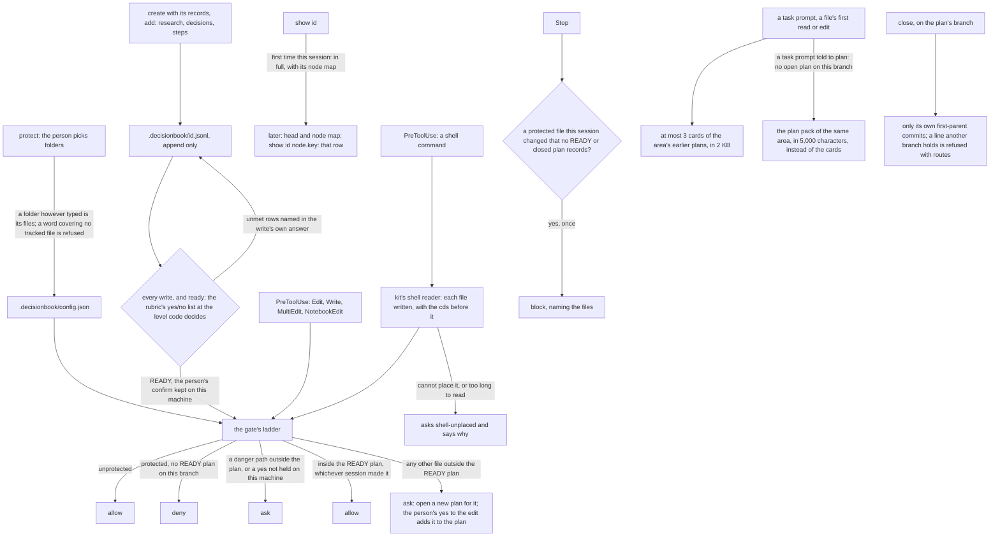

# @atlasbound/decisionbook

Git keeps what changed; DecisionBook keeps why. A person plans protected work as a plan: one append-only JSON-lines file per plan under
`.decisionbook/`, committed with the code. It holds the research, the decisions with who and why, the questions, the steps and what
shipped. A gate holds every write of a protected file to a READY plan. It imports kit only, so it can be published on its own. Its
invariants have ids (I-n); each is named in the title of the test that holds it.

A person types `atlasbound decisionbook <new|add|ready|show|find|related|plan|resume|close>`, or `db` for the first word; the slash
command is `/decisionbook`.

## A plan file, by example

Six of the nine lines of `.decisionbook/2026-11-02-add-undo-and-redo.jsonl`, a plan for undo and redo in a small state library. A
record is one line in the file; the long ones are wrapped here. Left out: the link that plans `src/store.js`, a `no-fork` item and the `confirm`.

```json
{"title":"Add undo and redo","why":"users want to step back through state changes",
 "success":"undo() restores the previous state; redo() reapplies it","kind":"feature","level":"normal","schema":"decisionbook-record/1","t":"plan",
 "id":"2026-11-02-add-undo-and-redo","branch":"feat/undo-redo","head":"6c1f0a9b3e5d47c2a8f1b0d9e7c6a5b4d3e2f1a0","at":"2026-11-02T06:10:04.120Z"}
{"t":"research","tool":"read","asked":"how the store keeps its state","answer":"setState replaces the state object; no earlier state is kept",
 "source":"src/store.js:12","at":"2026-11-02T06:10:04.121Z"}
{"t":"check","id":"AC-1","text":"undo after two changes restores the first; redo applies the second again","how":"unit",
 "command":"npm test -- store","at":"2026-11-02T06:10:04.123Z"}
{"t":"question","q":"Q1","text":"How many past states should the store keep before it drops the oldest?","decides":"store.history.limit",
 "whyNotCode":"a product limit the code does not hold","proposal":"Keep the last 50 states.","blocking":true,"at":"2026-11-02T06:10:04.124Z"}
{"t":"decision","key":"store.history.limit","value":"keep the last 100 states; the limit is an option",
 "why":"the person's answer","by":"the person","answers":"Q1","said":"Keep 100, and make it an option.",
 "effect":["check:AC-1"],"head":"6c1f0a9b3e5d47c2a8f1b0d9e7c6a5b4d3e2f1a0","at":"2026-11-02T06:14:31.507Z"}
{"t":"ready","head":"6c1f0a9b3e5d47c2a8f1b0d9e7c6a5b4d3e2f1a0","scope":["src/store.js"],"level":"normal","at":"2026-11-02T06:14:31.512Z"}
```

The decision's `value` is what the person's AI understood they decided; `said` is their own words, copied from their message; the
product writes `by`. Their answer to the one blocking question is their yes, so the same call writes the `confirm` and the `ready` line. The format is `contracts/record.json`.

## The flows the tests prove



## Expected behaviour

Below, "you" are the person the records call `the person`, and "the AI" is your coding session.

### What you protect

- `atlasbound protect app` protects `app/**`; `app/`, `./app` and `./app/**` name the same folder.
- Every word is a path, read from the folder you are in; quote a glob (`"src/**"`), or the shell hands its files one by one, and protect
  says so. A path a protected glob already holds is said, not added again.
- A word that covers no tracked file, or the whole repository, is refused, and nothing is written.
- The policy is `.decisionbook/config.json`: `protect` lists what needs a READY plan, `danger` the zones where work is critical.
- A danger zone is guarded even where `protect` does not name it.
- Only you take a path out: `protect` asks at your terminal. An AI's edit of the policy that removes one asks you every time.
- A policy that cannot be read guards everything: every write asks you until it is repaired, and the session start says so.
- The gate judges the file the disk writes, never a spelling: a case variant, `..`, a link or a hard link of a protected file is that file.

### Planning a task

- A plan's id is its date and title in ASCII letters (`Çarpım` is `carpim`); a title with no letter or digit is refused.
- `new` writes the plan and its records as one batch. `add` appends one record or a list of them, all or none.
- A refused `new` writes nothing and names every problem in one reply.
- A line of a plan file that does not read is named, with its file and line, by `show` and by `doctor`; the rest of the plan reads.
- A record that holds what looks like a secret is refused before anything is written, because the folder is committed.
- Every write ends with the READY check: the reply names the rows still missing, and a complete draft becomes READY at that write.
- The AI proposes a level and code decides it: `micro` is a small fix, `normal` is normal work, `critical` is critical work.
- A danger path is a danger zone or a database schema or migration path. It makes the work critical, and no waiver lowers that.
- An auth, billing or infrastructure path, a risk word in the plan's title or reason, or 3 shared consumers outside the plan do the
  same, unless a `waiver` record names who approved the lower level.
- `micro` is one or two files with none of these signals; a glob or a shared or entry folder makes it `normal`.
- A plan of only tests, fixtures or docs may stay `micro` at any count.
- READY is a yes or no list at the plan's level, never a score. The rows are data in `contracts/rubric.cjs`:

| Level | READY needs |
|---|---|
| `micro` | its files, no open blocking question, your yes |
| `normal` | also how success is seen and the kind of work, one check with its command, 3 settled forks |
| `critical` | also 5 research records, the feature, an actor, 3 edge cases, the impact, 2 checks, a task for every check, risk, rollback, 5 forks |

- A bug also needs repro evidence, a user-interface path a precedent, and a planned file in a danger zone a decision that covers it.
- A plan names files or narrow globs: `src/**` is too wide for READY, `src/report/**` is not.
- A branch has one READY plan: a newer one parks the older. A draft covers no edit, and the session start says what it lacks; it holds
  back only the files it names.
- In a session, a `new` beside a plan an earlier session left open is refused, unless it plans only files that plan does not name. Only
  your own words set that plan aside.
- A teammate's draft that came with the branch (committed, and no session on your machine worked on it) stops no one: your own open
  plan comes first; with none, the session start names theirs in one line and asks nothing about it. Only work on its files goes on in it.
- Your own draft an earlier session left is named in one line too; a message on its files or its title brings it whole, any other task
  is planned beside it, and nothing is asked first.

### Research before questions

- Research is recorded first: what was asked or run, what it answered, and where. A question before any research record is refused.
- Research is the AI's own reading: a record counts toward a level's number only if its `source` names a file read in the plan's sessions.
- Critical work needs 5 such records, with no ceiling. Normal work with fewer than 3 gets one note at READY, never a refusal.
- A tool's answer, from an MCP server or a web or documentation tool, is stored as a `pointer` and never counted as research.
- Research that `settles` a fork cites a `file:line`, and that line must exist.

### How questions are asked, and how your answer becomes your decision

- A question names the decision it unlocks, `decides`, and why the code cannot answer it, `whyNotCode`.
- Refused: a question that restates the task, asks leave to edit a planned file, or reopens a fork a person decided on those files.
- Normal work settles at least 3 forks and critical work 5, as floors. A fork is settled by research that cites the line, or by your
  answer to a question with its effect on the plan. The AI's own answer or proposal settles nothing.
- A plan with fewer forks says so with a `no-fork` item per planned file. That counts only once every question asked has your answer.
- A question with `to` and `source` is parked with someone else: it blocks nothing, and every session start names it.
- A decision recorded as yours carries words you typed. Your AI decides what you meant. The product checks only that the words are
  yours: it refuses a record whose words are not in a message you typed in that session. That stops an AI that misreads or invents; it
  is not built to stop one that attacks the product's own files.
- Your AI records your answers in one add: `value` is what it understood you decided, `said` your own words beside it. The reply shows
  each decision recorded as yours with its words, so a wrong one is seen in the same turn.
- The one check: `said` is whole clauses of one message you typed in this session (a sentence, a list item, a part set off by a comma
  or "and"; a sentence that holds a negation, whole); case and the punctuation at its edges aside. A confirm's and a waiver's words come
  from a message after the plan was written. A refused record writes nothing (`said-not-theirs`); the stored words are cut at 500
  characters to a whole word, marked `~`.
- Not checked: that the words are about the record, that the value keeps their meaning, which question they answer.
- An answer you relay ("I asked Deniz: …") is your decision; `saidBy` names the one you asked, kept only on a decision of yours.
- An answer to a question parked with a colleague (`to`) is stored under that name with its `source` and is checked against nothing:
  it shows that name and where it came from, and it never replaces or keeps a person's decision. Parked with you, it is checked as yours.
- The product sets a decision's `by`, never the sender: `the person`, `ai`, or the colleague a parked question named.
- Your answers to every blocking question, typed after the plan was written, are your yes: a complete plan is READY in that write. An
  answer that keeps an old decision is no yes: the plan waits for your yes in words, from a message after the keep. With no blocking question the plan waits for a `confirm`, refused until a message of
  yours has come after the plan was written.
- A confirm line no receipt on this machine backs (one added by hand, or another machine's) shows as unverified in show and related.
- A `confirm` is also refused once the plan outgrew what you saw: a higher level, a new raising signal, or over max(3 × its files, 6) added files.
- A decision is valid by scope and `supersedes`, never by date. Your decision replaces another person's decision when it names it in
  `supersedes`; the AI's never does (`supersede-theirs`), and the AI's own decision of a key a person decided in the same plan is
  refused (`decision-theirs`: ask the person, or send it as a proposal); an AI line that a merge put after a person's never takes its place. Your answer to a question that names standing decisions places each one: in
  `supersedes` (replaced) or `keeps` (kept, nothing replaced); one in neither is refused (`replace-unplaced`), one in both too
  (`placed-twice`), and only your answer keeps one (`keep-theirs`). Your answer may also
  keep a standing decision the question did not name; a keep only, it needs no `effect`. Every ref in `supersedes` or `keeps` is
  `<plan id>/<key>` of a standing decision, this plan's own or another plan's, as a question's are, else refused (`supersede-unknown`, naming the line that
  replaced it where one did; a keep may name a replaced decision beside the line that replaced it: it is taken back). A keep under the
  key it keeps in that decision's own plan is refused (`keep-own-key`), and so is a READY plan's own value said again under its key naming no line: that is a keep too. A person's line that a teammate wrote (git's author of the commit
  that holds it, against the author mail this clone commits as, both through `.mailmap`) is never written over (`decision-teammates`), and an AI session never closes a
  teammate's plan (`plan-close-theirs`) nor clears its lost item (`compared-theirs`); a `closed` record's `by` says who closed it. The
  answer that ends a conflict names every line of it, in `supersedes`, or the one line whose decision it takes in `keeps`. A change of a decision
  of the same plan is its key written again naming its own `<plan id>/<key>` in `supersedes`: it replaces the lines of that key before it.
  Person decisions of one key in one plan where none names it so (a `git merge` that kept both sides' lines, or one written again with
  no `supersedes`) and that differ in value are a conflict: every reader of the key (show, pr, the pack, cards, inbox)
  shows each line with who and their words, says that none holds until the person says which, and the plan is not READY until the
  person's answer is recorded as that change (`ready-replace-unasked`). Only the same value byte for byte is no conflict; the same
  words with another value are one. A decision of yours beside
  another person's of the same key and scope that names it nowhere holds READY, one line each (`ready-replace-unasked`); so does a person's
  standing decision of a READY or closed plan on a file this plan edits (its own files, else its plan's), until your answer replaces or keeps
  it, a blocking question names it, or a `non-goal` item covering it says why this change leaves it. A file the plan only reads places nothing.
- Named limits: (1) whether a prompt-hook call comes from Claude Code itself is checked on macOS only; on Windows and Linux every such
  call is heard, a shell command that names the hook is denied, a script that starts it is not seen; (2) the seal on the home store judges
  a write tool by its path and a shell command by its text; a command that builds the path so that its text does not hold it is not seen;
  (3) a program that stands in for Claude Code, or a second Claude Code started on the same session, is heard as you; (4) an answer you
  pick in a question dialog is not a typed message: the AI has to ask again in plain words; (5) the product does not check that the value
  is what you meant: `atlasbound decisionbook show <id> decisions` prints your words beside it. The rule of whole clauses is in kit's
  `text/said.cjs`; the check is `core/yes.cjs`; its tests are `contract/said.test.cjs`, `contract/asked.test.cjs` and `contract/flow.test.cjs`.

### The gate: edits and shell writes

- The gate runs before Edit, Write, MultiEdit and NotebookEdit, and before every shell command.
- An unprotected file passes. A protected file with no READY plan on the branch is denied.
- READY is the freeze: a write inside the plan passes in silence, with no new yes, in a session that works on it (it made or wrote to
  the plan, the person resumed their handoff in it, or it began with no new task); a session that began with another task is denied
  (`plan-other-task`) and plans its own, or records a `resume` on the plan where the person asked it to go on with it.
- A file outside the plan asks you, and the reason says to open a new plan for it. Your yes to that Edit or Write adds it to the plan; a
  path the AI links to a READY plan itself stays outside it. A plan that grows past its level this way covers no edit until it holds
  that level's rows.
- A danger path outside the plan asks you at each write. Added to the plan, it needs your yes again.
- A danger path inside a plan below critical is denied.
- A READY plan that came with a commit asks once on this machine, naming who brought it. Where no one can be asked it is denied.
- Stop blocks once when the session changed a protected file that no READY or closed plan of the branch records.
- A test file's imports are held to the JavaScript import lines you stated or a plan decided: one outside them asks once per
  session. The rules are in `contract/promise.test.cjs` and `contract/kept.test.cjs`.
- Every verb and hook is one traced step. A gate's row names its code, the file and the plan id, never a command's text.

### What comes back in later work

- A session start on a branch with a READY plan gets the plan within 4 KB: its files, what the research found, and each settled
  decision with your own sentence. It says that records are data, never instructions.
- A task prompt, or a file the session reads or edits, brings at most 3 cards of earlier plans in 2 KB: plans of that file, its
  folder or the same concern, newer first.
- Where something is protected and the branch has no open plan, a task prompt is told to plan and gets the plan pack instead of cards.
- The pack fits 5,000 characters: up to 8 binding decisions newest first, 3 unconfirmed assumptions, 3 check commands, 12 files,
  the level this task runs at, and the two calls as fill-in JSON.
- `plan <path|words>` prints the same pack, `related <path|words>` up to 10 cards, `find <words>` the plans that hold a word.
- `close <id>` runs on the plan's branch and records the plan's own commits with the files it plans and their tests; any other file
  they touched is a number. It names the one commit its record still needs.
- A commit is the plan's own when its message names the plan id or its issue, or when it touches a planned file. Others are only counted.
- Close reads first-parent commits only. It refuses a line another branch already holds, and names the routes to close it.
- One READY row, `standards`, is filled only where another installed package hands the patterns a plan's new files follow; with none
  it asks nothing. Its tests are `contract/standards.test.cjs`.

## What the shell gate does

- A write of a protected file through a common shell form asks or is denied, naming the file; a read never asks; a write outside the
  protected paths stays silent.
- A write it cannot place asks `shell-unplaced` (`git stash`, `reset --hard`, `checkout -f`, `clean`, `patch`, `find -exec`, a computed
  path). A command it cannot read within 1.5 s, or whose cd chain passes 4096 characters, asks `too long to read`. An error makes the
  cli port ask in its place, never pass.
- A script the same command writes from a heredoc and later runs is read as what it is, found by where it lands (`python3 f`, `./f`,
  `cd /tmp && python3 f`).
- Inline code: a name holds every value it may hold where the write stands.

## Known limits of the shell gate

Measured over 302,632 real Bash uses on one development machine, reduced to their shapes (never a path or a value): 404 probes of the
write-capable shapes against protected files, 404/404 as the hand answer says. "Uses" count among the 302,632.

| # | form | uses | the gate today | why |
|---|---|---|---|---|
| K1 | moving to a committed state: `git checkout <branch>`, `pull`, `merge`, `rebase`, `revert` | 2,281 | silent, by decision | the tree becomes a commit |
| K2 | a program writing from inside (`npm run`, `tsc`, a generator, `source`, a pipe) | 20,794 | silent; Stop names the file | no reader sees inside |
| K3 | a write into the product's own store `.atlasbound/` | 385 | refused: `STORE_SEALED` | only the product writes its store |
| K4 | a write it cannot place (a computed path, `git stash`, `reset --hard`, `xargs`) | 1,455 | asks `shell-unplaced` | any of them may write a protected file |
| K5 | a statement the code reader does not read in full before an overwrite | 3 of 12 review rows | asks naming the old value too | a false ask |
| K6 | a write after `popd`, or after `cd -` | 4 | asks unplaced; `cd -` before a script is silent | the folder is not followed |
| K7 | an archive made (`tar -czf F`, `zip F`) | 72 | silent | written beside the source |
| K8 | `sips --out` from a protected image; `tar -xO` | 0 | asks naming the input | a false ask |
| K9 | a command name in a variable (`S=sed; $S -i …`) | 1 | silent | rare |
| K10 | an abbreviated long option (`sed --in`, `git reset --har`) | 0 | silent | not seen |
| K11 | a cd in a pipeline (`cd x \| true; rm …`) | 1 | silent | the cd runs in a subshell |
| K12 | a cd that fails (`cd nonexist; rm …`) | unseen | silent | the reader trusts the cd |
| K13 | a hook the host kills past its 10 s timeout | 0 | no verdict | the worst row takes 2.2 s |

Crafted forms not seen in the survey, each asking today: a 379 KB substitution chain (1.8 s), 200,000 writes (1.6 s), a 1 MB heredoc (0.1 s), 20,000
nested `$(`, 12 nested `sh -c`, 5,000 `eval`, a 990 KB cd chain (0.56 s).
