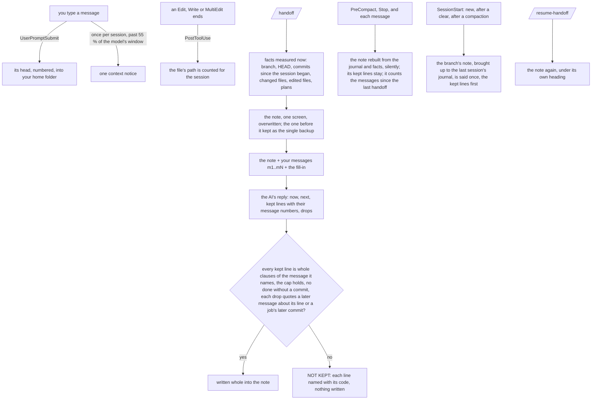

# @atlasbound/handoff

One note per branch that lets a fresh AI session continue where the last one stopped.

**What it keeps, and where.** The product keeps the head of each message you type (at most 1,200 characters, secrets screened, at most
60 per session; a message that is only a path or a bare slash command, such as the `C:/Program Files/Git/handoff` Git Bash makes of
`/handoff`, asks nothing and is not kept; of `/handoff <words>` your words are kept, the command's name is not) in your home folder, `~/.atlasbound/handoff-here/<hash of this repository>/`, so that a handoff can show them to your
AI again. The note is stored there too, and it is kept current without you: at every message and at the end of every turn it is
rebuilt from that journal and fresh facts (no model), so a session that ends any way at all (a closed terminal, a crash, `/clear`)
leaves the next one your last messages as you wrote them (whichever session heard them), the plan's state, your decisions with your sentences, and what
is still asked of you. A session reading the note sees its own messages first, then other sessions' under their own heading; what
a session running beside it sent after it began is that session's and left out. Nothing of it is in the repository. Nothing is sent anywhere. The product calls no model; the only
program it runs is git: the only AI is your own session. `atlasbound uninstall --purge` removes the folder. A session not seen for 14
days leaves it by itself: its message heads and its list of edited files. What a branch's note already quotes of them (its kept lines,
your last messages) stays in that note, and in its one backup, until the note no longer carries it or the folder is removed.

**Why.** In a long session the decisions and jobs you gave early are the first thing your AI forgets. At a handoff the product puts
your early messages in front of it again and takes back at most seven *kept* lines, each quoting the message it comes from. A kept line
holds your own words: whole clauses of the message it names (a sentence, a list item, a part you set off with a comma or "and"), case
and spacing aside, and a sentence that holds a negation only whole. A piece ("delete tests" out of "do not delete tests") or a
paraphrase is the AI's, not yours, and is refused (kit's one test of a person's words, the one DecisionBook uses). Kept lines stay from
one handoff to the next (twelve at most) until one is dropped openly. The AI drops a line only with your own words about that line
from a message you sent after it was kept: whole clauses that share the line's words or name its number, and say it is done, dropped,
cancelled or changed; a letter or an unrelated sentence drops nothing. A job also goes with a commit made since it was kept. Only you
reword a line, with `handoff drop` in your own terminal. The note and `debug handoff` show each dropped line and who dropped it.
Named limit: the words that mark a negation or an intent are a list (kit, `text/said.json`, several languages); polarity carried by
something it does not hold (a verb's ending, irony) is not seen, and a message head cut at its bound is read as far as it was kept.

## What you type

| You | What happens |
|---|---|
| `/handoff` in your AI session | the note is rebuilt from measured facts, your messages are listed again, your AI sends back `now`, `next` and `kept` once |
| `atlasbound handoff show` | the note as stored, with its age, and STALE when HEAD moved since |
| `atlasbound handoff drop 3` | you drop kept line 3; `atlasbound handoff drop 3 new words` rewords it; you type `drop kept line 3` at a plain terminal (an AI session, and a program that types for you such as tmux, are refused) |
| `atlasbound debug handoff` | why each kept line is there, what was dropped and why, what could not be measured |
| `/decide <area.topic> "<line>"` | DecisionBook, when it is on, makes a kept line a binding decision; the handoff keeps no second store |

## The flows the tests prove

## Expected behaviour

- It never blocks and never asks by itself. A hook that fails says nothing and the session goes on. Stop only rebuilds the note, silently.
- Every line of the note the product can measure, it measures; what it cannot measure it calls unknown. The three things only your
  session knows (`now`, `next`, `kept`) are written only when you ask for a handoff.
- The note is one screen (40 lines, 4,000 characters). When it is full, fact lines are left out and counted; a kept line never is.
- `done`, `complete`, `finished` and `works` are refused in a reply unless the same line names a commit that exists.
- Every hook and every verb writes one trace row with counts and codes, never a word of yours (`atlasbound debug trace --pkg handoff`).
- Every bound is data: `contracts/bounds.json`. Every printed sentence is data: `contracts/words.json` and `contracts/codes.cjs`.

The invariants have ids (I-n); each is named in the title of the test that holds it, under `contract/`.
